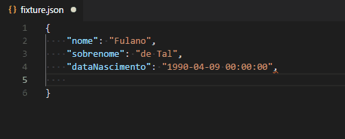
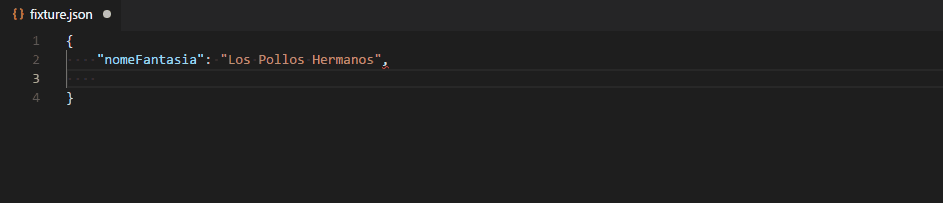

# Gerador de CPF/CNPJ

Esta extensão possibilita a inserção de CPF's e/ou CNPJ's gerados aleatoriamente, com ou sem máscara, diretamente no seu código.





## Utilização

Abra a paleta de comandos do VSCode através das teclas `Ctrl+Alt+P` e pesquise por **Gerar CPF** ou **Gerar CNPJ**, ou clique com o botão direito no arquivo que estiver editando e escolha a opção **Gerar CPF** ou **Gerar CNPJ**.

Em ambos os casos, o CPF ou CNPJ gerado será inserido na posição do cursor ou substituirá um trecho previamente selecionado.

Caso haja mais de um cursor, será gerado um CPF ou CNPJ diferente na posição de cada um dos cursores.

## Servidor MCP

A extensão disponibiliza um servidor MCP local chamado **Gerador de CPF/CNPJ**.

No chat em modo Agente, habilite as ferramentas do servidor e autorize sua execução quando solicitado pelo VS Code. Para localizar, iniciar ou reiniciar o servidor, use **MCP: List Servers** na paleta de comandos. A disponibilidade e a escolha das ferramentas dependem do cliente/agente e das políticas do VS Code.

| Ferramenta | ID | Argumentos |
| --- | --- | --- |
| Gerar CPF | `gerar_cpf` | `somenteNumeros?`, `quantidade?` |
| Gerar CNPJ | `gerar_cnpj` | `somenteNumeros?`, `habilitarCnpjAlfanumerico?`, `quantidade?` |
| Validar CPF | `validar_cpf` | `cpf` (string) |
| Validar CNPJ | `validar_cnpj` | `cnpj` (string) |

### Geração e overrides

Sem argumentos de override, a geração usa as configurações `geradorCpfCnpj.somenteNumeros` e `geradorCpfCnpj.habilitarCnpjAlfanumerico`. Os argumentos booleanos explícitos têm precedência, inclusive quando são `false`:

* `somenteNumeros: false`: com máscara, como `000.000.002-72`.
* `somenteNumeros: true`: sem máscara. Em CNPJ alfanumérico, **preserva as letras**.
* `habilitarCnpjAlfanumerico: false`: CNPJ apenas numérico, mesmo se a opção da extensão estiver habilitada.
* `habilitarCnpjAlfanumerico: true`: permite letras maiúsculas na base do CNPJ, mesmo se a opção estiver desabilitada.

Os dois overrides são independentes, valem apenas para a chamada atual e não alteram as configurações salvas. O modelo interpreta o pedido em linguagem natural e preenche esses argumentos; o servidor não interpreta frases diretamente.

Exemplos de pedidos:

* **"Gere um CPF válido"**: usa a configuração de formatação.
* **"Gere um CPF formatado"** ou **"Gere um CPF com formatação"**: `somenteNumeros: false`.
* **"Gere um CNPJ numérico formatado"**: `habilitarCnpjAlfanumerico: false` e `somenteNumeros: false`.
* **"Gere 10 CNPJs alfanuméricos sem máscara"**: `quantidade: 10`, `habilitarCnpjAlfanumerico: true` e `somenteNumeros: true`.

`quantidade` deve ser um inteiro entre **1 e 100**, com padrão **1**. Cada lote contém documentos válidos e distintos; não há garantia de unicidade entre chamadas diferentes. Quantidades inválidas retornam erro. O resultado sempre tem o formato `{ "documentos": ["..."] }`, também quando apenas um documento é solicitado.

As configurações padrão são lidas ao iniciar o processo MCP. Após alterá-las, **reinicie o servidor em MCP: List Servers** para aplicar os novos padrões. Overrides explícitos não exigem reinício. O servidor usa os valores de usuário/workspace da janela, sem escolher configurações por arquivo ativo ou por pasta em workspaces com múltiplas pastas.

### Validação

As ferramentas aceitam CPF numérico e CNPJ numérico ou alfanumérico, independentemente da configuração de geração. Informe o documento compacto ou com a máscara convencional; letras de CNPJ devem ser maiúsculas e os dois dígitos verificadores devem ser numéricos. Espaços, máscaras incompletas e caracteres extras são rejeitados.

A validação confere o formato e os dois dígitos verificadores e rejeita sequências repetidas, como `00000000000`. Não consulta a Receita Federal nem comprova existência, titularidade ou situação cadastral.

Exemplos:

* **"Valide o CPF 000.000.002-72"**.
* **"Valide o CNPJ 12.ABC.345/01DE-35"**.

O resultado é `{ "valido": true }` ou `{ "valido": false, "motivo": "..." }`. Documento inválido é um resultado normal da validação; argumentos com tipos incorretos ou obrigatórios ausentes retornam erro de ferramenta.

### Uso com arquivos

As ferramentas MCP **não alteram o editor**. Se você pedir apenas um documento, o agente pode responder no chat. Se pedir **"Preencha o CPF de cada pessoa neste JSON com valores diferentes"**, o agente pode gerar um lote e usar suas ferramentas de edição para atualizar o arquivo. Para garantir valores distintos na coleção, peça um único lote de até 100 documentos. As edições e suas autorizações ficam sob responsabilidade do agente/cliente.

## Configurações da extensão

Esta extensão disponibiliza as seguintes configurações:

* `geradorCpfCnpj.somenteNumeros`: habilita/desabilita a máscara nos CPF's e CNPJ's gerados; sem máscara preserva as letras do CNPJ alfanumérico
* `geradorCpfCnpj.habilitarMenuDeContexto`: habilita/desabilita opção de gerar CPF/CNPJ no menu de contexto
* `geradorCpfCnpj.habilitarCnpjAlfanumerico`: habilita/desabilita opção de gerar CNPJ alfanumérico

## Desenvolvimento

Use Node.js 22 ou superior para as ferramentas de desenvolvimento:

```sh
npm install
npm test
npm run package
```

Os testes executam no VS Code 1.101.0, incluindo validação, overrides, lotes, protocolo MCP em memória e stdio real, configurações e regressão dos comandos com múltiplos cursores. O build gera `dist/extension.js` e `dist/mcpServer.js`, com as dependências de runtime empacotadas.

Para testar manualmente sem gerar ou instalar VSIX, selecione **Run Extension** em **Executar e Depurar** e pressione **F5**. A tarefa de build inicia os watchers e abre o Extension Development Host. O matcher do esbuild está definido no próprio projeto, sem exigir extensão adicional. Na nova janela, use **MCP: List Servers** para iniciar o servidor e habilite suas ferramentas no chat em modo Agente. Depois de alterar o código, reinicie o MCP ou recarregue a janela de desenvolvimento, conforme o componente alterado.

## Release Notes

### 1.4.0

- Adicionado MCP local com ferramentas de geração e validação de CPF/CNPJ.
- Adicionados overrides por chamada de formatação e geração de CNPJ alfanumérico.
- Adicionada geração em lotes de até 100 documentos distintos.
- Versão mínima do VS Code atualizada para 1.101.

### 1.3.0

- Adicionada possibilidade de gerar CNPJ's alfanuméricos para testes da mudança anunciada pela RFB na Nota Técnica COCAD/SUARA/RFB nº 49/2024.

### 1.2.0

- Adicionada possibilidade de utilizar múltiplos cursores (contribuição de [Marcos Lacerda](https://github.com/marcosalpereira)).

### 1.1.1

- Adicionado ícone.
- Atualizando dependências para corrigir vulnerabilidades.

### 1.1.0

- Adicionado menu de contexto.

### 1.0.0

- Versão inicial.